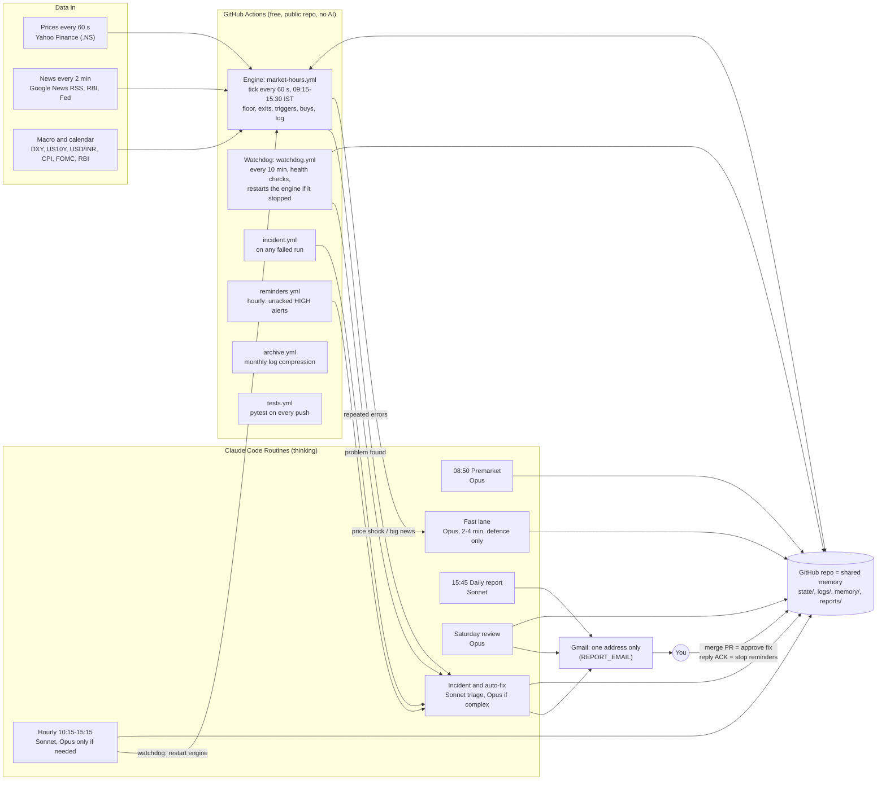
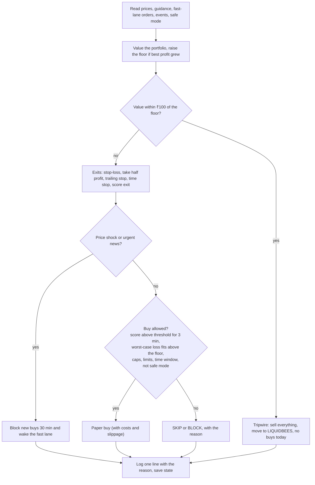

# simulate_gold: an autonomous metals paper-trader (₹1 lakh)

📊 Visual guide: [docs/ARCHITECTURE.md](docs/ARCHITECTURE.md) · Example day: [docs/DAY_IN_THE_LIFE.md](docs/DAY_IN_THE_LIFE.md)

**What this is.** A fully automated *paper-trading* simulator. No real money is used and no real orders
are placed. It manages a virtual ₹1,00,000 across three NSE instruments, decides every minute whether to
buy, sell or wait, writes a one-line reason for every decision, and emails a daily report.

**The one goal.** Be **green at every month end** (value ≥ ₹1,00,000). Profit size comes second. The rules
in [`docs/RULEBOOK.md`](docs/RULEBOOK.md) enforce this with a rising safety floor ("Green Guard").

| Instrument | What it is | Max share |
|---|---|---|
| GOLDBEES | gold ETF | 60% |
| SILVERBEES | silver ETF | 30% |
| HINDCOPPER | Hindustan Copper shares | 15% |
| LIQUIDBEES | liquid ETF where idle cash is parked (~6.3%/yr) | at least 30% at all times |

## Architecture



**Who decides what**
- The **engine** is the only thing that places (paper) orders. It follows fixed rules, uses no AI and never
  waits for Claude. If every routine fails, it keeps trading safely on its last guidance.
- **Claude routines** only advise. They can set a bias per metal (favour, neutral, block), add calendar
  events, and in the fast lane take *defensive* actions (sell part, tighten a stop, block buys). No routine
  can buy, lower the floor, loosen a stop or change the rules; the engine refuses it in code.
- **You** approve any code or rule change by merging a pull request. Replying to an email can only
  acknowledge it.

## How a decision is made (every 60 seconds)



**How often**
- Checks: every 60 s during NSE hours, about 375 a day. Exits can fire on any check.
- New buys: the signal must hold for 3 consecutive minutes. At least 30 minutes between buys, at most 3 buys a day
  (1 per instrument), none in 09:15–09:30 or after 15:00, none in the last 3 trading days of a month.
- 15:20: an overnight check reduces anything whose worst-case gap could push value below the floor.
- Claude input: bias at 08:50 and hourly, plus the fast lane within 2–4 minutes of big news (at most 4 a day).

**The Green Guard floor**
- It starts at ₹99,500 (at most ₹500 at risk in the first days). Once profit reaches ₹500 it becomes ₹1,00,000, and
  after that it is ₹1,00,000 + 50% of (best profit − ₹500).
- It never goes down, including across months.
- Every buy is sized so that, if all open positions gap down overnight by 3% (gold), 5% (silver) or
  7% (HINDCOPPER), value still stays above the floor.

## Daily report and alerts

- **15:50 every trading day:** an email with a green/red headline, market moves, every decision with its reason,
  holdings, where the day's profit came from, "Fixed today", and a system-health line. A button opens the
  interactive page (a chart with trade markers).
- **Incidents.** Each problem gets a fingerprint and a severity:
  - **HIGH** (engine stopped, floor at risk, corrupted state, tests failing on main): emailed immediately, then
    **re-sent every hour until you acknowledge** (button, reply "ACK", or comment `ack` on the GitHub issue). At most 24
    reminders.
  - **MEDIUM:** fixed automatically. Emailed only if it needs your approval or the fix failed (reminders at +1 h, +4 h,
    then daily).
  - **LOW:** fixed silently and listed in the daily email.
  - **Safe mode:** more than 5 incidents in a day, or a HIGH not fixed within 30 min, stops new buys (exits and floor
    keep working) until a verified fix or a clean pre-market check.
  - The incident routine wakes at most 6 times a day. Repeats of the same problem never wake it twice.
- **Approving a fix** means merging the pull request on GitHub (the email has "Review & merge" and "Reject"
  buttons).

## Memory (fixed cost per run)

Python condenses everything, and Claude reads only small summaries, so the cost per routine run does not grow
with history.

| Layer | File | Size | Read by |
|---|---|---|---|
| Raw logs | `logs/decisions-D.jsonl`, `logs/ticks-D.csv` | ~50 KB a day | Python only |
| Live brief | `memory/brief.md` (every 5 min, only new headlines) | ≤ 6 KB | every routine |
| Daily note | `memory/daily/D.md` | ≤ 15 lines | the last 3 |
| Lessons | `memory/lessons.md` (trimmed every Saturday) | ≤ 40 bullets | every routine |
| History | `data/daily_summary.csv` | 1 row a day | weekly review |

- `python tools/context.py` is the one command routines use to load context, with a hard cap of 25 KB.
- `python tools/should_think.py` decides for free whether Opus needs to think. If nothing changed, the hourly run
  ends in about 2 minutes.
- Monthly `archive.yml` gzips logs older than 35 days into `archive/YYYY-MM/`. `news.json` is capped at 48 h and
  400 items, and `seen_headlines.json` at 2,000 entries or 7 days.

## Routines

See [`routines/README.md`](routines/README.md) for the schedule table and stored prompts.

| Routine | When (IST) | Model |
|---|---|---|
| premarket | 08:50 weekdays | Opus |
| hourly | 10:15–15:15 weekdays | Sonnet, plus an Opus subagent only on THINK |
| fastlane | API, from the engine | Opus |
| daily_report | 15:45 weekdays | Sonnet |
| weekly | Saturday 09:50 | Opus |
| incident | API, from incident/watchdog/reminders/engine | Sonnet triage, Opus if complex |

## Fallback when Claude is unavailable

If the Claude routines cannot run (cloud-session credits and plan limits both used up), the engine keeps trading by its
fixed rules (it never needed Claude), but guidance goes stale and no daily report would arrive. Three free pieces cover this:

1. **Alarm, no AI.** `tools/healthcheck.py` reports `routines_silent` (HIGH) on a trading day when `state/guidance.json` is
   older than 3 h after 11:30 IST, or when there is no Claude-written `reports/daily/<today>.json` after 16:30 IST. The watchdog
   (`watchdog.yml`, also run at 16:45 IST) opens, or comments on, a GitHub issue **"Claude routines not running (usage limit or
   credits?)"** (label `routines-silent`); GitHub emails you about new issues in your own repo. It closes the issue when the
   check passes again.
2. **Guidance fallback.** `fallback.yml` runs `tools/fallback_brain.py`: DeepSeek reads `tools/context.py` (at most 25 KB, headlines
   treated as untrusted) and returns strict JSON with a bias per metal. Invalid answers become neutral, "favour" is downgraded to
   neutral when an event is today or tomorrow, and the result is applied only through `tools/guidance.py set` (note starts
   "[fallback: DeepSeek]"). It cannot touch the fast lane, events, sizes or limits. The next Claude run overwrites it.
3. **Report fallback.** At 16:50 IST, if there is no Claude report, `tools/fallback_report.py` builds the normal report files with
   Python (numbers come from the logs), adds a short DeepSeek paragraph (plain text, numbers checked against the facts), commits
   them and opens/updates the issue **"Daily report <date> (fallback mode)"**. If the secrets `SMTP_HOST`, `SMTP_USER`,
   `SMTP_PASS` (and optionally `SMTP_PORT`) exist, the same email is also sent with the subject "Metals Daybook · (fallback) ...".
   The Daybook Inbox needs Claude, so no Inbox item is created in fallback mode. Incidents get alerts only, never AI code fixes.
4. **Backup email.** If the missed daily report is still not sent 90 min after the 8th retry, `report-retry.yml` sends it once
   by Gmail SMTP (`tools/backup_email.py`, subject "... · backup (Claude unavailable)"). Setup: `docs/BACKUP_EMAIL.md`
   (secrets `SMTP_USER`, `SMTP_APP_PASSWORD`, `REPORT_EMAIL`).

**Setup (one step).** Add the secret **`DEEPSEEK_API_KEY`**: GitHub, Settings, Secrets and variables, Actions, New repository
secret. Never put the key in a file in the repo (it is public). For local testing copy `.env.example` to `.env` (git-ignored); real
environment variables always win over `.env`. Without the secret the fallback does nothing.

**Models.** `fallback:` in `config/params.yaml` lists preferred model IDs per tier (`thinking` for the bias decision, `fast` for
report text). At run time the code calls `GET /models` once and uses the first listed ID the account really has; if that call
fails it tries the list in order and moves on after a 400/404 "model not found". The chosen model is recorded in
`state/fallback.json`. Only the reply `content` is used; `reasoning_content` is never logged or stored.

**Cost.** DeepSeek reportedly charges about double in its peak hours (06:00-10:00 UTC on weekdays, which overlaps NSE hours).
The fallback makes only a few calls a day (at most one bias call an hour while Claude is down, plus one short summary), so the cost
is negligible.

## Thrift mode

Routines check their billing source first (`python tools/budget.py mode`, step 0 of every playbook). On the promotional cloud
credits the mode is NORMAL; on plan limits, or when unknown, it is THRIFT: no Opus subagent in the hourly routine, no Haiku
fan-out in premarket, a short weekly review, Opus in incidents only for HIGH/COMPLEX, and the engine allows 2 fast-lane
wake-ups a day instead of 4 (`budget:` in `config/params.yaml`). The daily report says "Thrift mode: running on plan limits".
No trading rule changes.

## Setup

1. GitHub secrets (Settings → Secrets and variables → Actions):
   - `ROUTINE_FIRE_URL` and `ROUTINE_FIRE_TOKEN` (the fast-lane routine's API trigger)
   - `ROUTINE_INCIDENT_URL` and `ROUTINE_INCIDENT_TOKEN` (the incident routine's API trigger)

   Everything works without them; you just lose the AI follow-ups.
2. Cloud environment for the routines: set the env var `REPORT_EMAIL` (the only address the Gmail hook allows),
   and allow the news and research sites in its network settings.
3. The workflows need Actions → General → Workflow permissions set to **Read and write**.

```bash
pip install -r requirements.txt
python -m pytest -q                    # CI runs Python 3.11
python run_live.py --once --force      # one tick now (no git sync unless SIMGOLD_GIT_SYNC=1)
python run_report.py --sample          # render the sample email and page into reports/daily/
python run_backtest.py                 # legacy backtest of the earlier design
```

## Repository layout

```
simgold/engine.py      per-tick decision logic          simgold/guard.py     floor, sizing, limits
simgold/score.py       entry score                      simgold/fastlane.py  triggers, routine wake-up
simgold/triggers.py    news keyword matcher             simgold/alerts.py    severity, reminders, safe mode
simgold/incidents.py   engine-side incident detection   simgold/gitsync.py   in-day commit/pull/push
simgold/brief.py       memory/brief.md writer           simgold/report.py    email, text, page
run_live.py            the minute loop                  run_report.py        daily report
tools/                 CLIs routines use (context, should_think, guidance, incident, healthcheck, archive, ...)
routines/              one playbook per routine         docs/RULEBOOK.md     the rules, with every number
config/params.yaml     every parameter                  .claude/hooks/       Gmail recipient lock
```

## Honest limits

- **Backtests:** the 2022–26 backtest of the *earlier* design made ~13%/yr against ~28%/yr for simply holding gold,
  and it did not reach 3–4% a month. The Green Guard rules are more conservative and have **not** been backtested
  yet. The expected range is roughly −0.3% to +1.2% a month.
- **No guarantee:** the floor is a rule, not a guarantee. A crash bigger than the gap allowance (silver has fallen ~25% in
  a day) can still cause a red month.
- **Data:** Yahoo NSE prices can lag by several minutes and sometimes have gaps. Paper fills are kinder than real ones.
- **Schedules:** GitHub's scheduled starts can be late (hours, in rare cases). That's why routines also start the engine
  and the watchdog is itself watched.
- **Holidays:** the NSE holiday list is best-effort; check it each year.
