# Architecture: a visual guide

**Paper trading only. No real money.** ₹1,00,000 is spread over GOLDBEES, SILVERBEES and HINDCOPPER (NSE); idle
money sits in LIQUIDBEES. The one goal is to be **green (at least ₹1,00,000) at every month end**.

The system has two halves. A rule-based **engine** on GitHub Actions makes every trading decision, once a minute,
with no AI. **Claude routines** do the thinking around it (a bias per metal, a calendar, defensive actions, notes)
and talk to the engine only through files in this repo. You see one email a day and decide only what you are asked.

This page is the index. Each picture is a standalone HTML file next to its PNG (in
[`architecture/`](architecture/)), so it can be edited and re-rendered.

> Thrift mode, the DeepSeek fallback, the billing check and the Daybook Inbox are described as designed. The
> thrift and fallback code lives on another branch, so check the details against it once merged.

---

## 1. The whole system

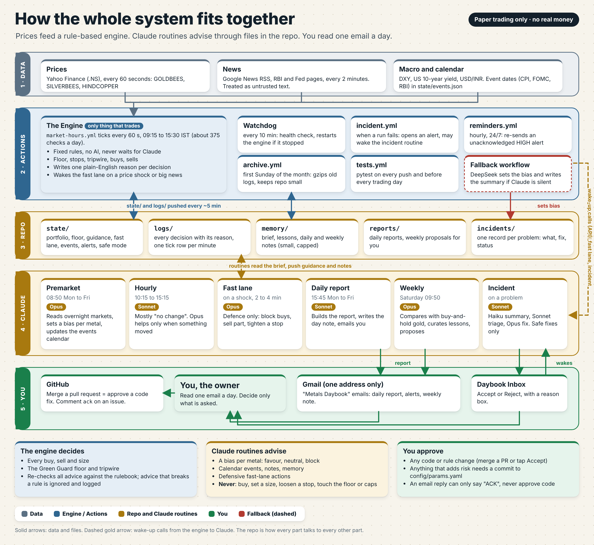

Data flows into the engine; the engine, the watchdog and the routines all share the repo as memory. Wake-up calls go
from the engine to Claude (dashed). The three cards at the bottom say who decides what: the engine decides trades,
routines only advise, and you approve anything that changes code or rules.

## 2. One decision every 60 seconds

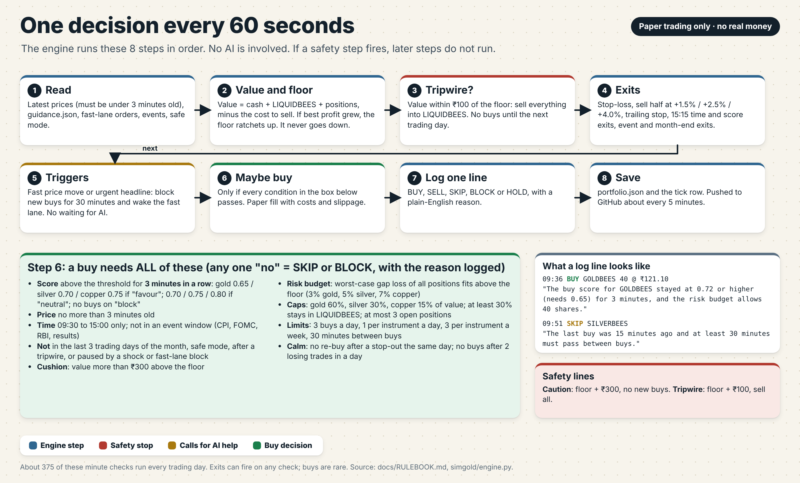

Eight steps, in order, about 375 times a day. The safety steps (floor, tripwire, exits) come before anything that
could buy. A buy needs every condition in the green box; the log line gives the reason in plain English.

## 3. What runs when

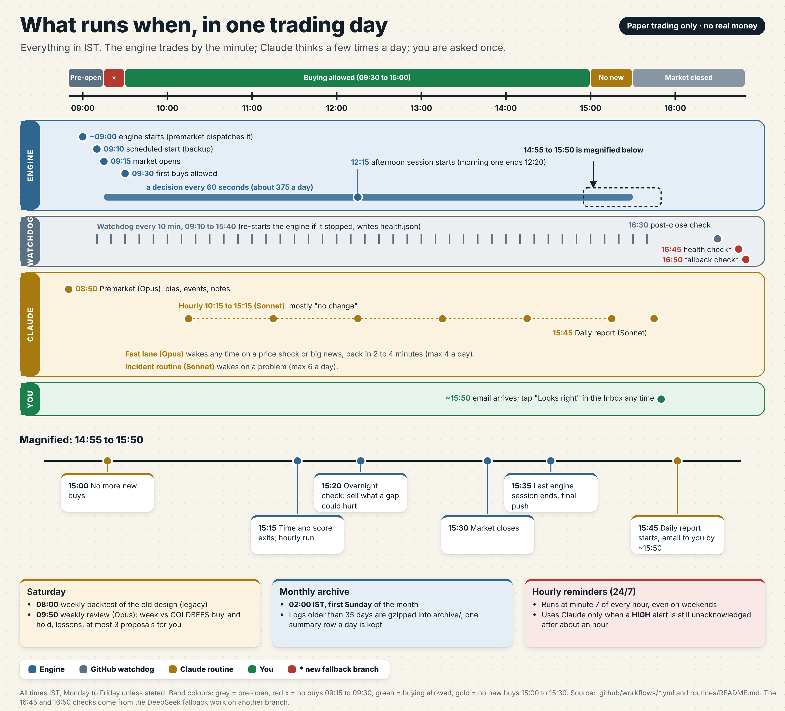

An IST timeline from 08:50 to 16:50, with the busy 14:55 to 15:50 stretch magnified. The engine runs by the
minute; Claude is used a few times a day; hourly reminders run all day and night but cost nothing unless a HIGH
alert is unacknowledged. Weekly and monthly jobs are at the bottom.

## 4. The Green Guard floor and sizing

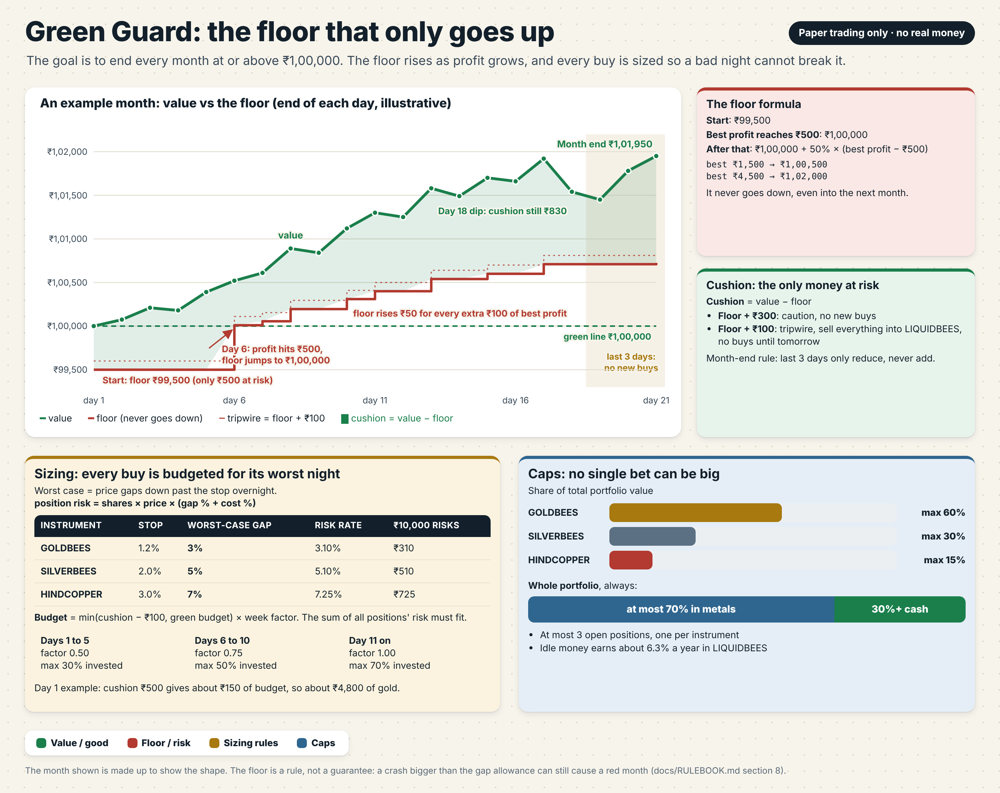

The floor starts at ₹99,500, becomes ₹1,00,000 once profit reaches ₹500, then rises by 50 paise for each extra
rupee of best profit. It never goes down. Every buy is sized for the worst night (gaps of 3%, 5% and 7%), and caps
keep each bet small (60% / 30% / 15%, at least 30% in cash).

## 5. Alerts and approvals

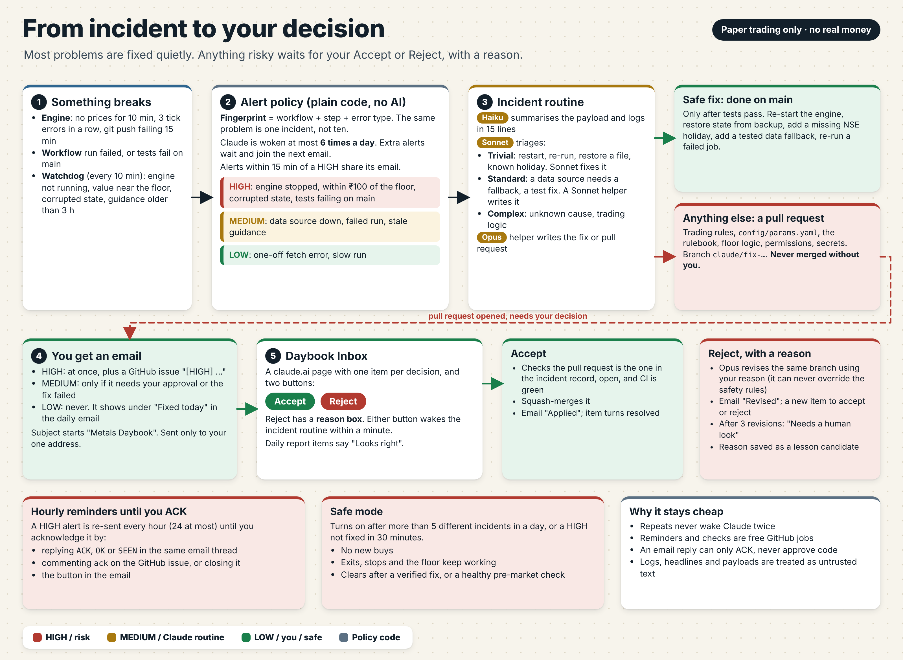

Problems are grouped by fingerprint and ranked HIGH, MEDIUM or LOW. Safe fixes are applied automatically; anything
that touches rules or risk becomes a pull request. You answer Accept or Reject (with a reason) in the Daybook Inbox.
HIGH alerts are re-sent every hour until you acknowledge them; safe mode stops new buys if things go badly wrong.

## 6. Memory

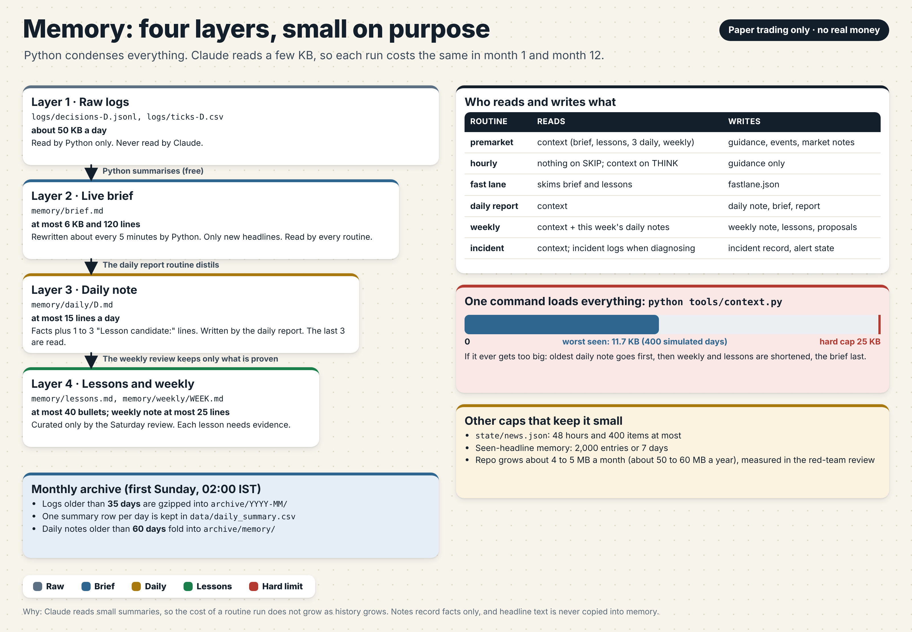

Four layers (raw logs, live brief, daily notes, lessons and weekly notes), each smaller than the one before. Claude
loads about 12 KB at most through one command, with a hard cap of 25 KB, so a run costs the same in month 12 as in
month 1. A monthly archive keeps the repo small.

## 7. Billing and fallback

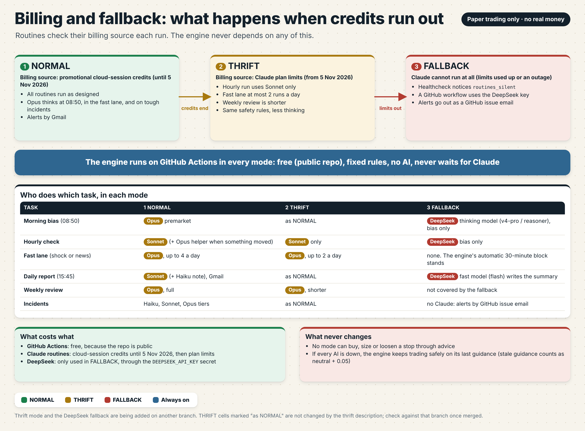

Routines check where their usage is billed. **Promotional cloud-session credits (until 5 Nov 2026) mean NORMAL.
Claude plan limits mean THRIFT**: hourly runs on Sonnet only, the fast lane at most 2 a day, a shorter weekly review.
If Claude cannot run at all, the healthcheck reports `routines_silent` and a GitHub workflow using the
`DEEPSEEK_API_KEY` secret sets the bias only (thinking model, v4-pro / reasoner) and writes the report summary
(fast model, flash); alerts then go out as a GitHub issue email. The engine always runs free on GitHub Actions.

## 8. Which model does what

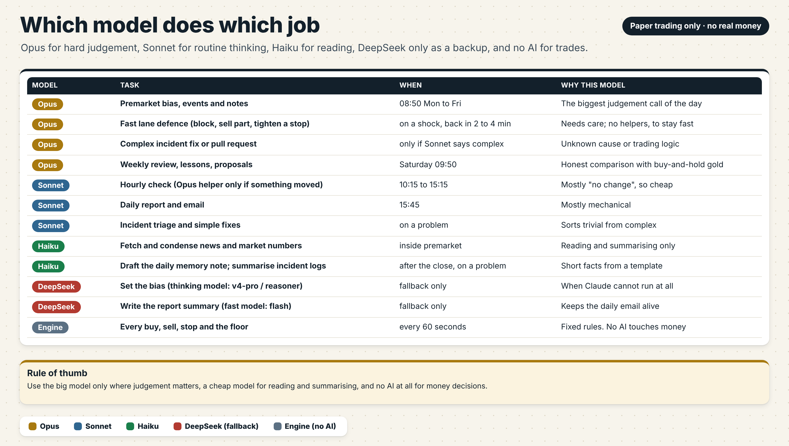

Opus for hard judgement (premarket, fast lane, complex incidents, weekly review), Sonnet for routine work (hourly,
daily report, incident triage), Haiku for reading and condensing, DeepSeek only as a fallback. The engine uses no AI.

## 9. Setup checklist

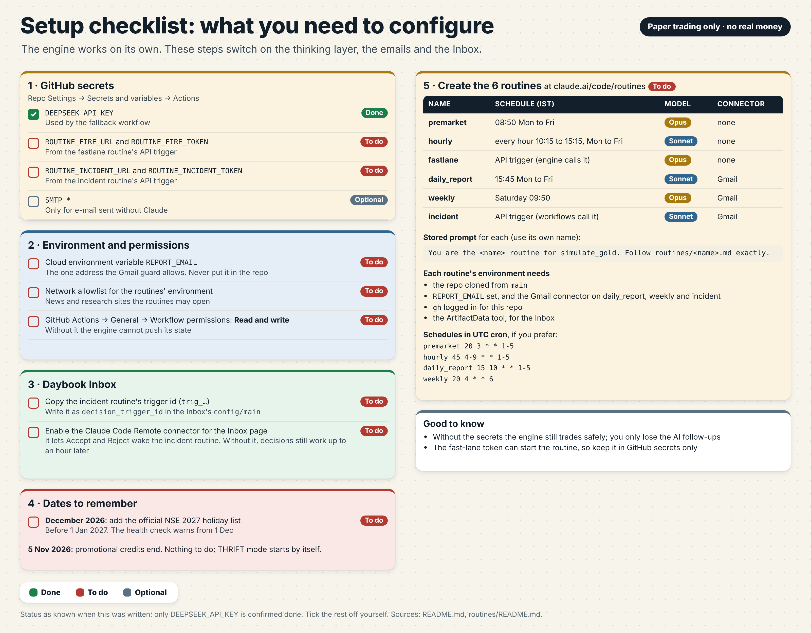

Everything you must configure: GitHub secrets, the cloud environment variable `REPORT_EMAIL`, the network allowlist,
Actions read/write permission, the six routines on claude.ai, the Inbox decision trigger id, and the 2027 holiday
list in December.

## 10. A day as a storyboard

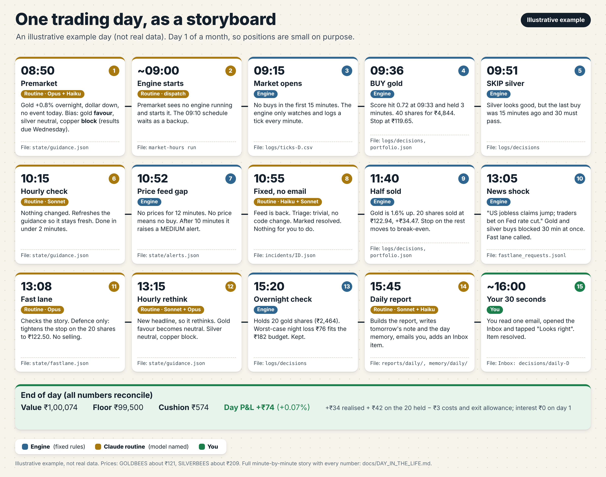

One made-up trading day in 15 cards. The same day, minute by minute with every number, is in
[`DAY_IN_THE_LIFE.md`](DAY_IN_THE_LIFE.md).

---

## Mermaid sources (editable, render on GitHub)

### The whole system, with thrift mode and the DeepSeek fallback

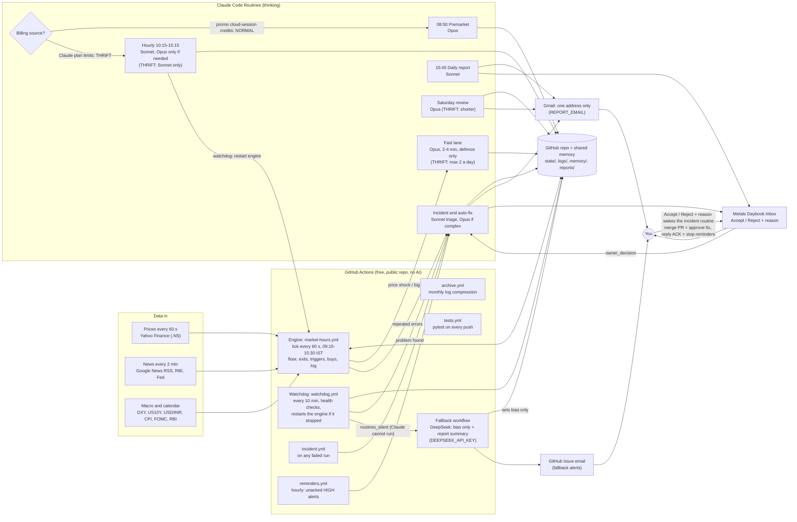

### One decision every 60 seconds

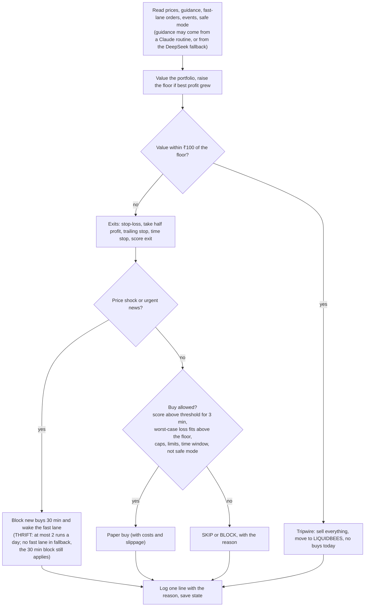

---

## When does what activate

Times are IST. "Fixed rules" means plain code with no AI.

| Trigger | Component | Condition | Result |
|---|---|---|---|
| Schedule, every trading day about 09:00 and 09:10 | Premarket routine dispatches the engine; `market-hours.yml` cron is the backup | No engine run in progress or queued | Engine session starts; loops every 60 s until 12:20 |
| Schedule 12:15 (backup cron) | `market-hours.yml` afternoon session | After the morning session | Engine continues until 15:35 |
| Schedule 08:50, Mon to Fri | Premarket routine (Opus) | NSE open today | Bias per metal, events added, market notes written to `state/` |
| Every 60 s, 09:15 to 15:30 | Engine (fixed rules) | Fresh prices | Floor, exits, triggers, maybe one buy, one log line |
| Score above threshold for 3 minutes | Engine | Every buy condition passes | Paper buy; BUY line with reason |
| Any minute | Engine | Value within ₹100 of the floor | Tripwire: sell everything, no buys until next trading day |
| Any minute | Engine | Price shock (e.g. gold ±0.6% in 10 min) or headline with urgency 4+ or two topics | Block new buys 30 min at once; wake the fast lane (max 4 a day, 2 in THRIFT) |
| Fast-lane call | Fast-lane routine (Opus) | Payload valid and plausible | One defensive action (block, sell part, tighten a stop) or none; never a buy |
| Hourly 10:15 to 15:15 | Hourly routine (Sonnet) | `should_think.py` says THINK (stale guidance, price move, headline, event, stop near, cushion low) | Opus helper (Sonnet only in THRIFT) rethinks bias; otherwise SKIP and refresh guidance |
| 15:00 | Engine | Any day | No new buys |
| 15:20 | Engine | Any day | Overnight check: sell positions whose worst-case night loss no longer fits |
| 15:45, Mon to Fri | Daily report routine (Sonnet) | After the engine ends | Report, day memory, email, Inbox item |
| Every 10 min, 09:10 to 15:40 | Watchdog workflow | Engine run or ticks missing | Re-dispatch the engine; raise an alert |
| 16:30 | Watchdog workflow | Post-close | Health check written to `state/health.json` |
| Alert raised | `alerts.py` policy, then the incident routine | New fingerprint, under 6 wake-ups a day | MEDIUM: auto-fix, email only if approval needed or fix failed. HIGH: email now plus GitHub issue |
| Hourly at :07, 24/7 | `reminders.yml` | A HIGH alert unacknowledged for 55+ min | Reminder email via the incident routine, up to 24 |
| More than 5 incidents in a day, or a HIGH unfixed for 30 min | Engine safe mode | Any time | No new buys until a verified fix or a clean pre-market check |
| You tap Accept or Reject in the Inbox | Incident routine, `owner_decision` mode | Item and revision match; for Accept the PR is open and CI is green | Accept: merge the PR. Reject: Opus revises with your reason (max 3 revisions) |
| Claude routines silent (health check `routines_silent`) | Fallback workflow (DeepSeek) | Claude cannot run | Bias only (thinking model) and report summary (fast model); alerts as a GitHub issue email |
| Billing source is Claude plan limits (after 5 Nov 2026) | Routines | Checked at each run | THRIFT: hourly Sonnet only, fast lane at most 2 a day, shorter weekly |
| Saturday 09:50 | Weekly routine (Opus) | Every week | Weekly note vs GOLDBEES buy-and-hold, lessons trimmed, at most 3 proposals |
| First Sunday of the month, 02:00 | `archive.yml` | IST day 1 to 7 | Logs older than 35 days gzipped, one summary row a day kept |
| Every push or pull request | `tests.yml` | Always | `pytest`. A failure on `main` is a HIGH alert |
| 1 December | Healthcheck | No 2027 holiday list | Warning to add the NSE 2027 holidays before 1 Jan 2027 |

---

## Read next

- [`DAY_IN_THE_LIFE.md`](DAY_IN_THE_LIFE.md): one example day, minute by minute (illustrative, not real data).
- [`RULEBOOK.md`](RULEBOOK.md): every rule and number; the source of truth.
- [`REDTEAM.md`](REDTEAM.md): what was attacked, what broke, what is still open.
- [`../routines/README.md`](../routines/README.md): the six routines, schedules and the owner's manual steps.
